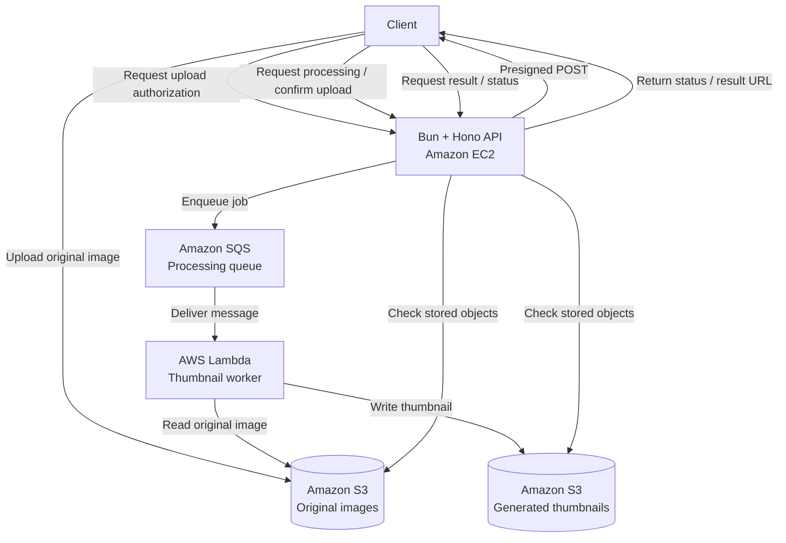

# Serverless Thumbnail Processing Pipeline

An asynchronous image thumbnailing service built with Bun, Hono, Amazon EC2, Amazon S3, Amazon SQS, and AWS Lambda.

The API handles upload authorization and job coordination, while image processing runs asynchronously in Lambda. This separates request handling from potentially time-consuming image processing.

## Features

- Generate thumbnails from uploaded images.
- Upload files directly to S3 using presigned POST requests.
- Process image jobs asynchronously through SQS and Lambda.
- Store original images and generated thumbnails in S3.
- Retrieve processing results through the API.
- Handle failed processing through SQS retries and a dead-letter queue.

## Architecture



> Adjust the diagram to match the actual trigger and status-checking mechanisms in your implementation.

## Request lifecycle

1. **Upload authorization:** The client requests permission to upload an image. The API generates a presigned POST with the configured upload restrictions.
2. **Direct upload:** The client uploads the original image directly to S3, avoiding the need to stream the entire file through the API server.
3. **Job submission:** The API enqueues a processing job in SQS after the upload workflow is confirmed.
4. **Asynchronous processing:** Lambda consumes the queued job, retrieves the original image, generates a thumbnail, and writes the output to S3.
5. **Result retrieval:** The client requests the processing status or thumbnail through the API. The API determines the available result using the implemented S3 object checks.

## Technology stack

| Technology | Responsibility |
|---|---|
| Bun | JavaScript/TypeScript runtime |
| Hono | HTTP API |
| Amazon EC2 | API hosting |
| Amazon S3 | Original image and thumbnail storage |
| Amazon SQS | Asynchronous job delivery |
| AWS Lambda | Image processing |
| [Image library] | Thumbnail generation |

## Getting started

### Prerequisites

- Bun
- AWS account and AWS CLI
- Appropriate AWS IAM permissions
- Access to the required S3 buckets, SQS queue and Lambda function

### Local development

Clone the repository:

```bash
git clone <repository-url>
cd <repository-directory>
bun install
```

Configure the required environment variables using the provided `.env.example`.

```bash
cp .env.example .env
```

Start the API using the project's development script:

```bash
bun run dev
```

Run tests:

```bash
bun test
```

See the configuration reference below for the required variables and AWS resources.

### Deployment

The production API runs on Amazon EC2, and image processing runs in AWS Lambda.

1. Configure the S3 buckets, SQS queue, DLQ, and Lambda function.
2. Configure the API environment and IAM permissions.
3. Deploy the Bun/Hono API to EC2.
4. Configure the Lambda function and SQS event source mapping.
5. Verify the upload, processing, failure, and result-retrieval flows.

See [deployment documentation](<deployment-documentation-path>) for the exact commands and configuration.

## Design decisions and limitations

### Presigned POST uploads

The API issues presigned POST policies so clients can upload directly to S3. The policy can enforce supported content types and a maximum file size.

These restrictions reduce unnecessary traffic through the API and reject some invalid uploads before storage. Content-type metadata alone does not prove that a file contains a valid image, so the processing worker must still validate its input.

### S3-derived status

Processing status is derived from the presence of expected S3 objects rather than maintained in a separate job-status database.

This avoids a separate status store, but it limits the status model. Object presence can establish that an output exists; it does not necessarily explain whether a job is queued, actively processing, or permanently failed. Intermediate states and failure reasons require additional tracking if needed.

### Retries and dead-letter queue

SQS and Lambda support retrying failed processing attempts. Messages that exceed the configured receive threshold are routed to the DLQ according to the queue's redrive policy.

The DLQ provides a place to inspect failed jobs and investigate errors. It does not automatically resolve them. Recovery requires an operational procedure for diagnosing and redriving eligible messages.

### Authentication

Authentication is intentionally omitted from this version to keep the project focused on the asynchronous processing pipeline.

As a result, the service should not be treated as a production-ready public service without appropriate access controls, upload restrictions, abuse prevention, and cost safeguards.

## Testing

The project includes [describe the tests that actually exist].

Important scenarios to validate include:

- Successful thumbnail generation.
- Unsupported and corrupted image uploads.
- Duplicate message delivery.
- Lambda processing failures and retries.
- DLQ routing after repeated failures.
- Missing original images or generated thumbnails.
- Presigned POST expiration and size/type restrictions.

## Future improvements

- Add persistent job state and failure reasons.
- Add CloudWatch dashboards and alarms.
- Automate infrastructure provisioning and deployment.
- Add authentication, rate limiting, and per-user quotas.
- Add load tests and document throughput, latency, and cost.

## License

[Specify your license, if applicable.]