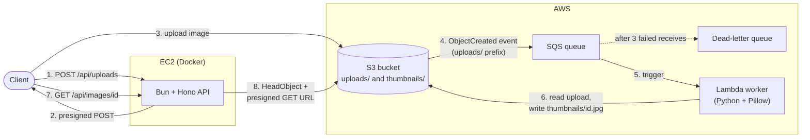

# Image Thumbnailer

Upload an image, get a thumbnail back. A small event-driven pipeline on AWS: a Bun + Hono API hands out presigned S3 uploads, and a Python Lambda generates the thumbnails asynchronously. All infrastructure is defined with OpenTofu.

## Architecture



1. The client asks the API for an upload slot.
2. The API returns a presigned POST for `uploads/<uuid>.<ext>`. The image never passes through the API.
3. The client uploads directly to S3.
4. S3 sends an `ObjectCreated` event to SQS, only for keys under `uploads/`.
5. SQS triggers the Lambda worker.
6. The worker writes a 256px JPEG thumbnail to `thumbnails/<uuid>.jpg`.
7. The client polls the API for status.
8. Once the thumbnail exists, the API returns a short-lived presigned download URL.

## Stack

| Part | Tech |
|---|---|
| API | Bun, Hono, Zod, OpenAPI (Scalar docs at `/reference`), Pino |
| Worker | Python 3.12, Pillow, AWS Lambda (x86_64) |
| AWS | S3, SQS (+ DLQ), Lambda, EC2, IAM, CloudWatch |
| Infra | OpenTofu (modules: `s3_bucket`, `sqs_queue`, `lambda_function`, `ec2_instance`) |
| Runtime | Docker + Docker Compose on EC2 |

## API

| Endpoint | Description |
|---|---|
| `POST /api/uploads` | Body `{ "contentType": "image/jpeg" }` (JPEG, PNG, or WebP). Returns `{ id, url, fields, expiresIn }`, a presigned POST. |
| `GET /api/images/:id` | Returns `{ "status": "pending" }` or `{ "status": "ready", "thumbnailUrl", "expiresIn" }`. |
| `GET /health` | Liveness check. |
| `GET /reference` | Interactive API docs (OpenAPI spec at `/openapi.json`). |

## Design decisions

- **Presigned POST instead of PUT.** S3 itself enforces the 10 MB limit and the declared content type, and pins the object key. Clients can't upload outside their assigned key or bypass the limits by skipping the API.
- **Status comes from S3, not a database.** The API checks whether `thumbnails/<id>.jpg` exists. Fewer moving parts for a project this size.
- **Partial batch failures.** The worker reports failed messages individually (`ReportBatchItemFailures`), so one bad image doesn't retry the whole batch.
- **Retries and a DLQ.** After 3 failed receives, a message moves to the dead-letter queue (14-day retention). The queue's 180s visibility timeout is 6x the Lambda's 30s timeout.
- **No processing loop.** The S3 notification is filtered to `uploads/`, so writing thumbnails never retriggers the worker.
- **The worker checks the real image format**, not the file extension, and strips metadata (EXIF/GPS). Transparency is flattened onto white for JPEG output.
- **No static AWS credentials anywhere.** The API uses the EC2 instance role. IMDSv2 is required (hop limit 2 so containers can reach it), and shell access is through SSM Session Manager, with no SSH and only port 80 open.
- **Private bucket** with public access blocked, default encryption, and TLS-only policies on the bucket and queue.
- **Least-privilege IAM, defined once per consumer.** The worker reads `uploads/*` and writes `thumbnails/*`. The API does the reverse (put uploads, get thumbnails, list the bucket).

## Known limits

- **No auth.** The API is public by design for this demo. Rate limiting on `POST /api/uploads` would be the next step.
- **Failed jobs stay `pending`.** Without a database there's no failure status, and an unknown ID also looks `pending`. Failures are visible in CloudWatch and the DLQ.
- **HTTP only.** The API has no TLS (S3 URLs are HTTPS regardless). A reverse proxy or load balancer would add it.
- **Single instance**, no autoscaling, and the public IP changes if the instance is stopped and started.

## Repository layout

```
apps/
  api/          Bun + Hono API (Dockerfile, src/, .env.example)
  worker/       Python Lambda (src/, tests/, requirements*.txt)
infra/
  modules/      s3_bucket, sqs_queue, lambda_function, ec2_instance
  envs/
    dev/        root module for the dev environment
    prod/       same layout with different values (not deployed)
scripts/        smoke-test.sh, break-it.sh
docker-compose.yml
```

## Running locally

**API** (needs AWS credentials, e.g. from the AWS CLI, and an existing bucket):

```bash
bun install
cp apps/api/.env.example apps/api/.env   # set AWS_REGION and S3_BUCKET
cd apps/api && bun run --hot src/index.ts
```

**Worker tests:**

```bash
cd apps/worker
python -m venv .venv && source .venv/bin/activate   # Windows: .venv\Scripts\activate
pip install -r requirements-dev.txt
pytest
```

## Deploying

1. **Build the Lambda zip** (Linux wheels, so Pillow works on Lambda):

```bash
   cd apps/worker
   rm -rf dist
   pip install -r requirements.txt --platform manylinux2014_x86_64 \
     --only-binary=:all: --implementation cp --python-version 3.12 --target dist/package
   cp src/*.py dist/package/
   python - <<'EOF'
   import pathlib, zipfile
   root = pathlib.Path("dist/package")
   with zipfile.ZipFile("dist/worker.zip", "w", zipfile.ZIP_DEFLATED) as z:
       for p in root.rglob("*"):
           if p.is_file() and "__pycache__" not in p.parts:
               z.write(p, p.relative_to(root).as_posix())
   EOF
```

2. **Apply the infrastructure.** Set `environment` and `bucket_name` in `infra/envs/dev/terraform.tfvars`, then:

```bash
   cd infra/envs/dev
   tofu init
   tofu plan
   tofu apply
```

3. **Start the API on the instance.** Open a shell via EC2 > Connect > Session Manager, then:

```bash
   git clone <this-repo-url> && cd image-thumbnailer
   # create apps/api/.env with PORT=3000, APP_URL, AWS_REGION, S3_BUCKET
   sudo HOST_PORT=80 docker compose up -d --build
```

   `S3_BUCKET` comes from `tofu output -raw bucket_name`, and the instance IP from `tofu output -raw api_public_ip`.

## Testing

```bash
API_URL=http://<ip>/api bash scripts/smoke-test.sh photo.jpg   # upload, then wait for the thumbnail
API_URL=http://<ip>/api bash scripts/break-it.sh photo.jpg     # presigned POST limits and validation
```

`break-it.sh` checks that a tampered key, a wrong or missing content type, and an oversized file are all rejected by S3. A text file renamed to `.jpg` should end up in the DLQ after retries.

## Teardown

```bash
cd infra/envs/dev
tofu destroy
```

The dev bucket uses `force_destroy`, so it is removed even when it contains objects. The instance runs 24/7 while it exists, so stop it when you're not demoing.